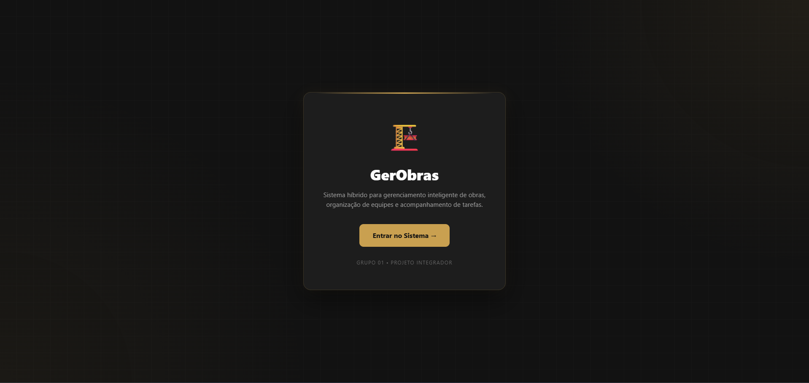
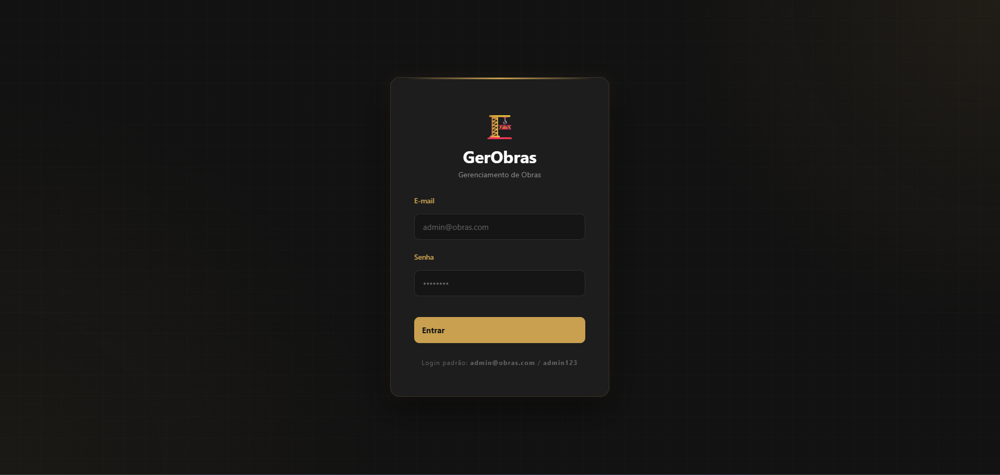
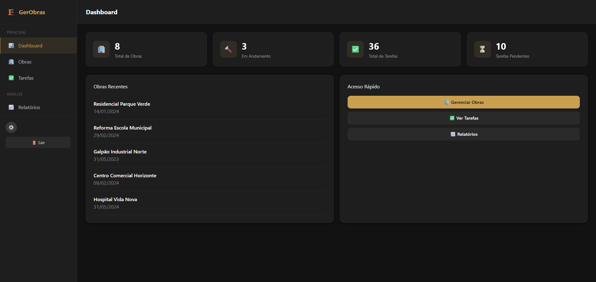
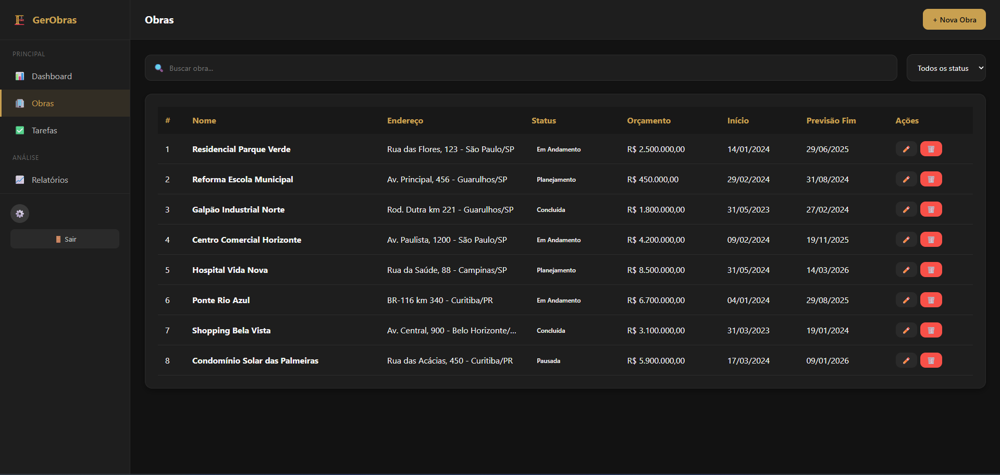
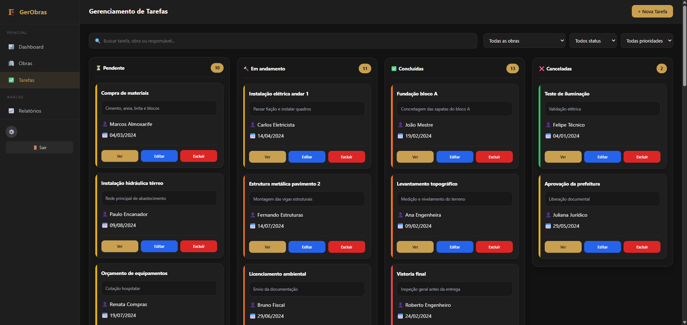
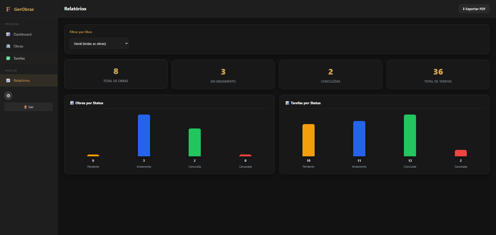
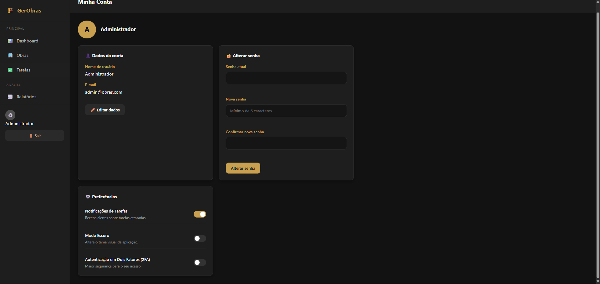
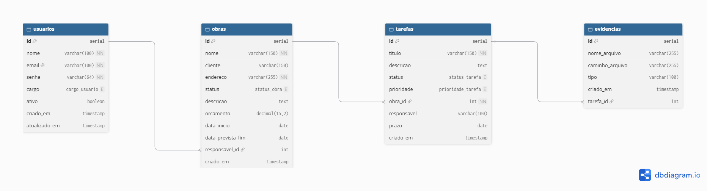

# GerObras — Sistema Híbrido de Gestão de Obras

<div align="center">


**Prova de Conceito (PoC) e Produto Mínimo Viável (MVP) voltados à construção civil**  
*Desenvolvido segundo o princípio offline-first para mitigar falhas de conectividade entre o escritório e o canteiro de obras.*

---

**Centro Universitário SENAC – Campus Santo Amaro**  
**Curso de Tecnologia em Análise e Desenvolvimento de Sistemas (TADS)**  
**Projeto Integrador: Análise de Soluções Integradas para Organizações (2026)**  
*Orientador: Prof. Anderson Clayton Garcia Lopes*

[Visão Geral](#-visão-geral-do-produto) • [Personas](#-personas-e-partes-interessadas) • [Funcionalidades](#-funcionalidades-principais) • [Telas do Sistema](#-telas-do-sistema) • [Arquitetura](#-arquitetura-e-tecnologias) • [Modelo de Dados](#-modelo-de-dados-mer) • [API REST](#-api-endpoints) • [Instalação](#-como-instalar-e-executar) • [Vídeo](#-vídeo-demonstrativo) • [Autores](#-autores)

</div>

---

## 📋 Índice

- [Visão Geral do Produto](#-visão-geral-do-produto)
- [Personas e Partes Interessadas](#-personas-e-partes-interessadas)
- [Funcionalidades Principais](#-funcionalidades-principais)
- [Telas do Sistema e Galeria](#-telas-do-sistema)
- [Arquitetura e Tecnologias](#-arquitetura-e-tecnologias)
- [Lógica Offline-First e PWA](#-lógica-offline-first-e-pwa)
- [Modelo de Dados (MER e Dicionário)](#-modelo-de-dados-mer)
- [API Endpoints](#-api-endpoints)
- [Como Instalar e Executar](#-como-instalar-e-executar)
- [Credenciais e Dados Iniciais](#-credenciais-e-dados-iniciais)
- [Vídeo Demonstrativo](#-vídeo-demonstrativo)
- [Autores](#-autores)
- [Licença](#-licença)

---

## 🏗️ Visão Geral do Produto

A construção civil caracteriza-se por um ambiente operacional dinâmico, no qual a execução das atividades depende da circulação contínua de informações entre equipes técnicas, administrativas e operacionais. Entretanto, a dependência de registros em papel, planilhas descentralizadas e aplicativos de mensagens instantâneas dificulta a rastreabilidade das decisões, a conferência de evidências e o controle de prazos.

O **GerObras** é um **Sistema Híbrido de Gestão de Obras** concebido para estabelecer um canal estruturado e digital entre o escritório técnico e o canteiro. O sistema opera sob a premissa de que a indisponibilidade de internet não pode interromper a operação de campo: o aplicativo web progressivo (PWA) armazena recursos em cache e registra operações pendentes em fila local, realizando a **sincronização automática** com a API assim que a conectividade é restabelecida.

### Comparativo de Paradigma

| Domínio de Gestão | Paradigma Convencional | Sistema Digital Híbrido (GerObras) |
| :--- | :--- | :--- |
| **Atribuição de tarefas** | Comunicação verbal, quadros físicos e impressos | Interface Kanban rastreável, com prazos, prioridades e responsáveis |
| **Coleta de evidências** | Fotos soltas em mensageiros instantâneos | Evidências fotográficas anexadas diretamente ao identificador da tarefa |
| **Conectividade em campo** | Interrupção do registro quando cai o sinal | Operação contínua em cache local, com sincronização em background |
| **Relatórios e auditoria** | Consolidação manual de planilhas e relatórios | Geração estruturada de KPIs, gráficos de status e exportação direta em PDF |

---

## 👥 Personas e Partes Interessadas

O sistema foi modelado a partir do mapeamento de três personas centrais alinhadas aos perfis de acesso previstos no banco de dados (`admin`, `engenheiro` e `mestre_de_obras`):

### 1. Ricardo Almeida — Administrador / Gestor da Construtora (`admin`)
- **Perfil:** 46 anos, formado em Administração com MBA em Projetos. Atua majoritariamente no escritório (desktop/notebook).
- **Necessidades:** Visão consolidada de todas as obras simultâneas, acompanhamento orçamentário, controle de cronogramas e exportação de relatórios gerenciais em PDF para diretoria e investidores.
- **Dor resolvida:** Elimina a dependência de planilhas defasadas e chamadas telefônicas para saber a situação real de cada canteiro.

### 2. Camila Ferreira — Engenheira Civil (`engenheiro`)
- **Perfil:** 31 anos, 7 anos de experiência, dividindo a rotina entre escritório técnico e visitas semanais aos canteiros (notebook e smartphone).
- **Necessidades:** Desdobrar o cronograma em tarefas claras, definir prioridades e responsáveis, acompanhar o fluxo no quadro Kanban e validar a conformidade da execução por evidências fotográficas.
- **Dor resolvida:** Centraliza fotos e atualizações técnicas diretamente nas tarefas, substituindo grupos informais de mensagens.

### 3. João Carlos Mendes — Mestre de Obras (`mestre_de_obras`)
- **Perfil:** 52 anos, 25 anos de experiência prática em canteiros. Utiliza smartphone Android diretamente em campo, frequentemente em subsolos ou áreas com sinal oscilante ou ausente.
- **Necessidades:** Consultar rapidamente as tarefas prioritárias do dia, atualizar o status das frentes de serviço e anexar fotos do trabalho concluído sem burocracia.
- **Dor resolvida:** Interface PWA leve e responsiva com suporte *offline-first*, garantindo que nenhuma anotação seja perdida por queda de conexão.

---

## ✨ Funcionalidades Principais

- **Gestão Centralizada de Obras:** Cadastro completo (CRUD via modal) com nome, endereço, status, orçamento previsto, datas de início e previsão de término e descrição, além de busca textual e filtro por status.
- **Quadro Kanban Operacional:** Organização das atividades em 4 colunas (*Pendente*, *Em andamento*, *Concluída* e *Cancelada*), com contadores dinâmicos e filtros combinados (busca textual, obra, status e prioridade).
- **Sinalização Visual de Prioridades:** Destaque visual nos cartões para prioridades *Urgente*, *Alta*, *Média* e *Baixa*, com modal de visualização detalhada.
- **Upload e Associação de Evidências Fotográficas:** Envio de imagens (`MultipartFile`) vinculadas diretamente à tarefa via endpoint dedicado (`POST /tarefas/{id}/evidencias`).
- **Painel de Indicadores (Dashboard):** Visão sintética dos KPIs (Total de Obras, Em Andamento, Total de Tarefas, Tarefas Pendentes), listagem de obras recentes e atalhos de acesso rápido.
- **Módulo de Relatórios Analíticos:** KPIs consolidados, gráficos de barras de obras e tarefas por status, tabela detalhada filtrável por obra e **Exportação direta para PDF** via `html2pdf.js`.
- **Gerenciamento de Conta e Perfil:** Visualização e edição de nome e e-mail com persistência no banco e alteração segura de senha validada por hash SHA-256.
- **Arquitetura PWA & Offline-First:** Web App Manifest (`manifest.json`), Service Worker (`sw.js`) para cache de ativos estáticos e fila de requisições offline persistida em `localStorage` (`gerobras_offline_queue`).

---

## 📸 Telas do Sistema

Todas as telas foram desenhadas seguindo a abordagem responsiva *mobile-first* com a identidade visual **Dark Gold**:

### 1. Tela Inicial e Autenticação
Acesso rápido com validação de credenciais na API REST e controle de sessão via `sessionStorage`.

| Tela Inicial (Splash) | Tela de Login |
| :---: | :---: |
|  |  |

---

### 2. Dashboard Gerencial
Painel executivo com cartões métricos dinâmicos, obras recentes e navegação rápida.

<div align="center">
  
</div>

---

### 3. Módulo de Gestão de Obras
Listagem tabular completa de projetos com pesquisa em tempo real, filtro por status e operações CRUD via modal.

<div align="center">
  
</div>

---

### 4. Quadro Kanban de Tarefas e Evidências
Controle visual das etapas de execução, filtros combinados, upload de evidências fotográficas e modal de detalhes.

<div align="center">
  
</div>

---

### 5. Relatórios Gerenciais e Exportação em PDF
Painel analítico com KPIs consolidados, gráficos de barras dinâmicos por status, tabela por obra e geração de PDF via `html2pdf.js`.

<div align="center">
  
</div>

---

### 6. Configurações da Conta
Gerenciamento de credenciais, atualização de nome e e-mail e alteração segura de senha.

<div align="center">
  
</div>

---

## 🛠 Arquitetura e Tecnologias

```
                    ┌──────────────────────────────────────────────┐
                    │               CLIENTE (FRONTEND)             │
                    │   HTML5 • CSS3 (Dark Gold) • Vanilla JS      │
                    │   Fetch API • PWA (Service Worker + Storage) │
                    └──────────────────────┬───────────────────────┘
                                           │ HTTP/REST (JSON) — :5030
                                           ▼
                    ┌──────────────────────────────────────────────┐
                    │              BACKEND (API RESTFUL)           │
                    │   Java 17 • Spring Boot 3.3.5                │
                    │   Spring Web • Spring Data JPA               │
                    │   Spring Security (CORS) • Flyway            │
                    └──────────────────────┬───────────────────────┘
                                           │ JDBC / PostgreSQL Driver
                                           ▼
                    ┌──────────────────────────────────────────────┐
                    │          BANCO DE DADOS RELACIONAL           │
                    │   PostgreSQL (Local / Supabase + Supavisor)  │
                    └──────────────────────────────────────────────┘
```

### Tecnologias Empregadas
- **Backend:** Java 17, Spring Boot 3.3.5, Spring Web (`spring-boot-starter-web`), Spring Data JPA, Spring Security, Flyway (`flyway-core` e `flyway-database-postgresql`), Maven.
- **Frontend:** HTML5, CSS3, JavaScript (Vanilla), Fetch API, `html2pdf.js` (v0.10.1), Service Worker (`sw.js`) e Web App Manifest (`manifest.json`).
- **Banco de Dados:** PostgreSQL (suporte a execução local e implantação gerenciada via Supabase com agrupamento de conexões Supavisor).
- **Segurança:** Hash criptográfico SHA-256 via `HashUtil` e política de CORS configurada para as origens `http://localhost:5501` e `http://127.0.0.1:5501`.

---

## 📱 Lógica Offline-First e PWA

1. **Cache de Ativos (`sw.js`):** O Service Worker realiza o pré-cache das páginas HTML, folhas de estilo CSS e scripts JS no momento da instalação (`gerobras-cache-v1`), garantindo abertura rápida em redes instáveis.
2. **Fila de Operações Offline (`api.js`):** Caso uma requisição de escrita (`POST`, `PUT` ou `DELETE`) falhe por ausência de conectividade (`TypeError` no `fetch`), a operação é enfileirada no `localStorage` sob a chave `gerobras_offline_queue`.
3. **Sincronização Automática:** Um *listener* no evento `window.addEventListener('online', syncOfflineQueue)` reenvia sequencialmente as requisições pendentes ao backend assim que o dispositivo recupera o sinal.

---

## 🗄 Modelo de Dados (MER)

### Diagrama Entidade-Relacionamento (DER)
<div align="center">
  
</div>

### Dicionário de Dados do MVP

#### Tabela `usuarios`
| Campo | Tipo | Restrições | Descrição |
| :--- | :--- | :--- | :--- |
| `id` | SERIAL | PK | Identificador único do usuário |
| `nome` | VARCHAR(100) | NOT NULL | Nome completo |
| `email` | VARCHAR(100) | NOT NULL, UNIQUE | E-mail de autenticação |
| `senha` | VARCHAR(64) | NOT NULL | Hash SHA-256 da senha |
| `cargo` | cargo_usuario | ENUM (`admin`, `engenheiro`, `mestre_de_obras`, `operario`) | Perfil de atuação |
| `ativo` | BOOLEAN | DEFAULT TRUE | Status do usuário no sistema |
| `criado_em` | TIMESTAMP | DEFAULT CURRENT_TIMESTAMP | Data de cadastro |
| `atualizado_em` | TIMESTAMP | DEFAULT CURRENT_TIMESTAMP | Data da última alteração |

#### Tabela `obras`
| Campo | Tipo | Restrições | Descrição |
| :--- | :--- | :--- | :--- |
| `id` | SERIAL | PK | Identificador único da obra |
| `nome` | VARCHAR(150) | NOT NULL | Nome do empreendimento |
| `cliente` | VARCHAR(255) | NULL | Cliente ou incorporadora contratante |
| `endereco` | VARCHAR(255) | NOT NULL | Endereço completo do canteiro |
| `status` | status_obra | ENUM (`planejamento`, `em_andamento`, `pausada`, `concluida`, `cancelada`) | Situação da obra |
| `descricao` | TEXT | NULL | Escopo e observações técnicas |
| `orcamento` | DECIMAL(15,2) | DEFAULT 0.00 | Orçamento total aprovado |
| `data_inicio` | DATE | NULL | Início dos serviços |
| `data_prevista_fim` | DATE | NULL | Data estimada para entrega |
| `responsavel_id` | INT | FK -> `usuarios(id)` | Responsável técnico |
| `criado_em` | TIMESTAMP | DEFAULT CURRENT_TIMESTAMP | Registro de criação |

#### Tabela `tarefas`
| Campo | Tipo | Restrições | Descrição |
| :--- | :--- | :--- | :--- |
| `id` | SERIAL | PK | Identificador único da tarefa |
| `titulo` | VARCHAR(150) | NOT NULL | Título da ordem de serviço |
| `descricao` | TEXT | NULL | Detalhamento das instruções técnicas |
| `status` | status_tarefa | ENUM (`pendente`, `em_andamento`, `concluida`, `cancelada`) | Coluna no fluxo Kanban |
| `prioridade` | prioridade_tarefa | ENUM (`baixa`, `media`, `alta`, `urgente`) | Nível de urgência |
| `obra_id` | INT | NOT NULL, FK -> `obras(id)` ON DELETE CASCADE | Vínculo com a obra |
| `responsavel` | VARCHAR(100) | NULL | Nome do responsável operacional |
| `prazo` | DATE | NULL | Data limite para conclusão |
| `criado_em` | TIMESTAMP | DEFAULT CURRENT_TIMESTAMP | Registro de criação |

#### Tabela `evidencias`
| Campo | Tipo | Restrições | Descrição |
| :--- | :--- | :--- | :--- |
| `id` | SERIAL | PK | Identificador da evidência |
| `nome_arquivo` | VARCHAR(255) | NULL | Nome original do arquivo enviado |
| `caminho_arquivo` | VARCHAR(255) | NULL | Caminho local (`uploads/`) ou URL em storage |
| `tipo` | VARCHAR(255) | NULL | MIME-type (ex: `image/jpeg`, `image/png`) |
| `criado_em` | TIMESTAMP | NULL | Data e hora do registro (`@PrePersist`) |
| `tarefa_id` | BIGINT | FK -> `tarefas(id)` | Vínculo com a tarefa |

---

## 🔌 API Endpoints

A API segue as convenções RESTful e executa por padrão em `http://localhost:5030`:

### Autenticação
- `POST /login` — Autentica com `email` e `senha`, validando o hash SHA-256 e retornando os dados do usuário (`200 OK`, `401 Unauthorized` ou `404 Not Found`).

### Gestão de Obras
- `GET /obras` — Lista todas as obras cadastradas com dados resumidos.
- `GET /obras/{id}` — Retorna os detalhes completos de uma obra específica.
- `POST /obras` — Cadastra uma nova obra.
- `PUT /obras/{id}` — Atualiza os dados de uma obra existente.
- `DELETE /obras/{id}` — Exclui uma obra e suas tarefas vinculadas em cascata.

### Gestão de Tarefas e Evidências
- `GET /tarefas` — Lista todas as tarefas do quadro Kanban.
- `POST /tarefas` — Cria uma nova tarefa vinculada a uma obra.
- `PUT /tarefas/{id}` — Atualiza status, prioridade, responsável, prazo ou descrição da tarefa.
- `DELETE /tarefas/{id}` — Exclui uma tarefa e suas evidências associadas.
- `POST /tarefas/{id}/evidencias` — Realiza o upload de imagem comprobatória via `multipart/form-data` (campo `file`), armazenando o arquivo no diretório `uploads/`.
- `GET /tarefas/evidencias/{id}` — Recupera e serve a imagem da evidência fotográfica com o `Content-Type` apropriado (`image/jpeg`, `image/png`) para visualização no navegador.

### Gestão de Usuários
- `PUT /usuarios/{id}` — Atualiza `nome` e `email` do usuário (com verificação de unicidade de e-mail).
- `PUT /usuarios/{id}/senha` — Altera a senha mediante conferência de `senhaAtual` e aplicação de hash SHA-256 em `novaSenha`.

---

## 🚀 Como Instalar e Executar

### Pré-requisitos
- **Java 17 JDK** instalado e configurado no `PATH`.
- **Maven 3.8+** (ou utilizar o wrapper `./mvnw` / `mvnw.cmd` incluso).
- **PostgreSQL 15+** (localmente ou via instância Supabase).
- Navegador moderno (Chrome, Edge ou Firefox).

### 1. Clonar o Repositório
```bash
git clone https://github.com/Felpsz-Brucciamolino/PROJETO-INTEGRADOR_ANALISE-DE-SOLUCOES-INTEGRADAS-PARA-ORGANIZACOES.git
cd PROJETO-INTEGRADOR_ANALISE-DE-SOLUCOES-INTEGRADAS-PARA-ORGANIZACOES
```

### 2. Configurar o Banco de Dados
Crie o banco de dados no PostgreSQL:
```sql
CREATE DATABASE gerenciamento_obras;
```
As credenciais podem ser configuradas via variáveis de ambiente (`DB_URL`, `DB_USERNAME`, `DB_PASSWORD`) ou ajustadas em `backend/src/main/resources/application.properties`:
```properties
spring.datasource.url=${DB_URL:jdbc:postgresql://localhost:5432/gerenciamento_obras}
spring.datasource.username=${DB_USERNAME:postgres}
spring.datasource.password=${DB_PASSWORD:postgres}
```
*As tabelas base e os dados iniciais são aplicados automaticamente pelo **Flyway** (`V1__Criacao_banco_dados.sql`, `V2__Injecao_dados.sql` e `V3__Inserir_personas.sql`), enquanto as colunas e entidades complementares (como `evidencias`) são sincronizadas pelo **Hibernate JPA** (`spring.jpa.hibernate.ddl-auto=update`).*

### 3. Executar o Backend
```bash
cd backend
./mvnw spring-boot:run
```
*(No Windows, utilize `mvnw.cmd spring-boot:run`.)*  
A API estará disponível em: `http://localhost:5030`

### 4. Executar o Frontend
Para respeitar as regras de CORS configuradas em `SecurityConfig.java` e habilitar o registro do Service Worker (`/sw.js`), sirva a pasta `frontend` na porta `5501`:

```bash
# Opção com Python:
cd frontend
python -m http.server 5501

# Ou com Node.js:
cd frontend
npx serve -p 5501
```
Acesse no navegador: `http://localhost:5501/paginas/login.html`  
*(Opcionalmente, sirva a raiz do repositório na porta `5501` — por exemplo, via Live Server no VS Code — para iniciar pela tela de Splash em `index.html`.)*

---

## 🔑 Credenciais e Dados Iniciais (Personas)

As migrations do Flyway populam automaticamente o banco com as **3 personas documentadas**, **8 obras** e **36 tarefas** distribuídas entre os projetos:

| Persona / Usuário | Perfil | E-mail | Senha Padrão |
| :--- | :--- | :--- | :--- |
| **Ricardo Almeida** | `admin` | `admin@obras.com` | `admin123` |
| **Camila Ferreira** | `engenheiro` | `camila@obras.com` | `admin123` |
| **João Carlos Mendes** | `mestre_de_obras` | `joao@obras.com` | `admin123` |

*Todas as senhas são persistidas com hash SHA-256 (`240be518fabd2724ddb6f04eeb1da5967448d7e831c08c8fa822809f74c720a9`).*

---

## 🎥 Vídeo Demonstrativo

Apresentação funcional e demonstração técnica do MVP (2 a 3 minutos):

<div align="center">

[](https://www.youtube.com/watch?v=YZhSO3G_0Nw)

🔗 **[Clique aqui para assistir ao vídeo no YouTube](https://www.youtube.com/watch?v=YZhSO3G_0Nw)**

</div>

---

## 👥 Autores

Projeto desenvolvido pelo **Grupo 01** para o Projeto Integrador do SENAC Santo Amaro:

- **Ayanne Victória Lima Santos** — [@annyvick](https://github.com/annyvick)
- **Ariene Karenne de Andrade Machado** — [@arienekarenne](https://github.com/arienekarenne)
- **Emerson Eduardo Aires Nunes** — [@EmersonAiresIntegrador](https://github.com/EmersonAiresIntegrador)
- **Felipe Augusto Brusamolin de Souza** — [@Felpsz-Brucciamolino](https://github.com/Felpsz-Brucciamolino)
- **Haremitsu Sebin Raffaini** — [@Haremitsu](https://github.com/Haremitsu)
- **Raphael Tettmann da Silva** — [@Tettmann](https://github.com/Tettmann)

**Orientador:** Prof. Anderson Clayton Garcia Lopes

---

## 📄 Licença

Este projeto está licenciado sob a licença **MIT** — consulte o arquivo de licença para mais detalhes.